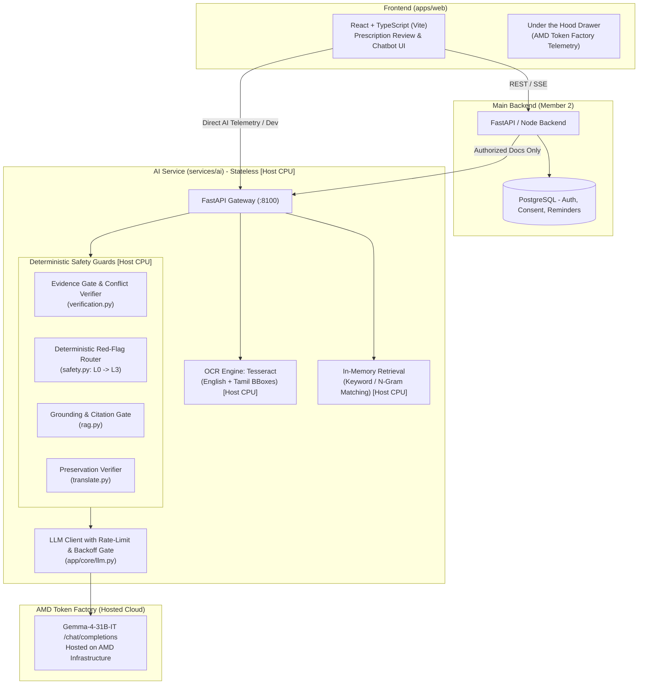

# CareBridge AI: Patient-Centered Prescription & Care Companion

> **AMD Developer Hackathon ACT III (lablab.ai)**  
> **Track 2: Health and Wellbeing**  
> *Hardware Acceleration: LLM on AMD Token Factory (hosted) with ROCm™ infrastructure, OCR & embeddings on Host CPU*

CareBridge AI bridges patient health literacy, clinical safety, and accessibility. It digitizes paper prescriptions (supporting both English and Tamil), verifies extracted dosages against deterministic clinical safety gates, and provides a citation-grounded conversational assistant that empowers patients while keeping healthcare professionals firmly in the loop.

---

## Architecture Overview

CareBridge AI follows a strictly decoupled, stateless architecture. The AI service performs no database operations and trusts no document content, ensuring strict isolation between user data and AI inference.



### Technology Stack & Hardware Acceleration

| Component | Technology | Target Hardware | Purpose |
|---|---|---|---|
| **Vision & LLM** | Gemma 4 (`Gemma-4-31B-IT`) | **AMD Token Factory (Hosted)** | Prescription structured extraction & grounded conversational reasoning |
| **Retrieval Engine** | In-Memory Keyword / N-Gram Matching | **Host CPU** | In-memory search over prescription lines & patient leaflets (bge-m3 not loaded) |
| **OCR Pipeline** | Tesseract OCR (`eng` + `tam`) | **Host CPU** | Text line tokenization, confidence scoring, and bounding box geometry |
| **Safety Engine** | Pure Python / Pydantic v2 | **Host CPU** | Deterministic evidence verification, red-flag routing, citation filtering |
| **Web Frontend** | React 19, TypeScript, Vite, Motion | Browser | Visual audit viewer, side-by-side image verification, chat companion |

---

## Run in 10 Minutes

You can launch CareBridge AI locally in less than 10 minutes using either **Mock Mode** (zero GPU required, instant demo) or **AMD ROCm Mode** (real GPU inference).

### Prerequisites
- Docker & Docker Compose
- Node.js (v18+) & npm (for web frontend)
- *For ROCm GPU execution*: AMD Instinct GPU with ROCm drivers (`/dev/kfd`, `/dev/dri`) or access to AMD Developer Cloud / Token Factory.

---

### Option A: Instant Run via Docker Compose (Mock Mode, Zero GPU Needed)

Mock Mode returns realistic, synthetically validated fixtures identical in shape to real ROCm model outputs.

1. **Clone the repository:**
   ```bash
   git clone https://github.com/SANDHIYAPRIYADHARSHINI/CareBridge.git
   cd CareBridge
   ```

2. **Configure environment:**
   ```bash
   # AI Service
   cp services/ai/.env.example services/ai/.env
   # Ensure MOCK_MODE=true is set in services/ai/.env

   # Main Backend (Member 2)
   cp services/backend/.env.example services/backend/.env

   # Web Frontend
   cp apps/web/.env.example apps/web/.env
   # Ensure VITE_AI_BASE_URL=http://localhost:8100 is set in apps/web/.env
   ```

3. **Start the AI service:**
   ```bash
   docker compose up ai-service
   ```
   *The AI service is now live and healthy at `http://localhost:8100/v1/health`.*

4. **Start the Main Backend (Member 2):**
   ```bash
   cd services/backend
   python -m venv .venv
   source .venv/bin/activate  # On Windows: .venv\Scripts\activate
   pip install -r requirements.txt

   # Run all automated tests (44 tests including full E2E demo journey)
   pytest -v

   # Start the backend server
   uvicorn app.main:app --reload --port 8080
   ```
   *The main backend is live at `http://localhost:8080` (managing authentication, caregiver consent, reminders, and hospital capacity).*

5. **Start the web application:**
   ```bash
   cd apps/web
   npm install
   npm run dev
   ```
   *Open `http://localhost:5173` in your browser. You can immediately upload sample prescriptions from `apps/web/public/` (e.g. `rx_demo_001.png`), review extracted medicines, and test grounded chat.*

---

### Option B: Run with AMD Token Factory (Hosted Endpoint)

To run inference against the hosted AMD Token Factory:

1. **Configure AMD Token Factory in `services/ai/.env`:**
   ```bash
   MOCK_MODE=false
   LLM_BASE_URL=https://developer.amd.com.cn/radeon/api/v1
   LLM_API_KEY=your_amd_token_factory_key
   LLM_MODEL=Gemma-4-31B-IT
   LLM_MAX_CONCURRENCY=3
   ```

2. **Run AI Service:**
   ```bash
   cd services/ai
   python -m venv .venv
   source .venv/bin/activate  # On Windows: .venv\Scripts\activate
   pip install -r requirements.txt

   uvicorn app.main:app --host 0.0.0.0 --port 8100 --reload
   ```

3. **Verify AMD Telemetry:**
   Visit `http://localhost:8100/v1/health` or press `.` in the web interface to open the **Under the hood** drawer and inspect live AMD Token Factory status and client-side latency.

---

## Safety Architecture (Track 2: Health and Wellbeing)

CareBridge is built on the core principle: **"We read and explain; clinicians decide."**  
AI models never have the final word on medical safety. Our architecture maps directly to the five critical safety dimensions evaluated in Track 2:

```
+-----------------------------------------------------------------------------------+
|                           INCOMING PATIENT PROMPT / IMAGE                         |
+-----------------------------------------------------------------------------------+
                                          |
                                          v
+-----------------------------------------------------------------------------------+
| 4. HIGH-RISK DECISIONS: Deterministic Red-Flag Router (data/redflags.json)        |
| - Level 3 Emergency (Chest pain, stroke, self-harm) -> Immediate Emergency Screen |
| - Level 2 Clinical Advice (Dose changes, stopping drugs) -> Refuse & Escalate     |
| - Level 1 General Info -> Pharmacist confirmation notice                          |
+-----------------------------------------------------------------------------------+
                                          | [Passed to RAG & Model]
                                          v
+-----------------------------------------------------------------------------------+
| 2. SENSITIVE INFO & PRIVACY: Stateless Execution Boundary                         |
| - Zero DB access; temp uploads removed in finally blocks; zero PHI logged         |
| - Documents quarantined in XML <document> tags against prompt injection           |
+-----------------------------------------------------------------------------------+
                                          |
                                          v
+-----------------------------------------------------------------------------------+
| 1. UNSUPPORTED RESPONSES: Grounding & Citation Gate                               |
| - Every factual statement requires citation to an OCR line or reference leaflet   |
| - Uncited sentences stripped; unsupported responses trigger templated refusal     |
+-----------------------------------------------------------------------------------+
                                          |
                                          v
+-----------------------------------------------------------------------------------+
| 3. UNCERTAIN RESULTS: Evidence Gate & Discrepancy Checks                          |
| - Fields without OCR evidence marked 'unclear'; dual-pass conflicts flagged       |
| - Low-confidence STT triggers spoken confirmation loop before processing          |
+-----------------------------------------------------------------------------------+
                                          |
                                          v
+-----------------------------------------------------------------------------------+
| 5. HUMAN REVIEW: Visual Audit & Clinical Guardrails                               |
| - Reminders blocked until patient visually confirms amber flags against image     |
| - Tamil translations locked to verified clinical phrases with digit preservation   |
+-----------------------------------------------------------------------------------+
```

### 1. Handling Incorrect or Unsupported Responses
- **Strict Grounding Gate:** The conversational assistant does not answer from generalized model memory. Every factual sentence produced must carry explicit citations linking to OCR line IDs from the user's uploaded prescription or verified patient leaflets (`data/reference/drugs.json`).
- **Citation Filtering & Sentence Stripping:** Before returning any response, our pipeline verifies each sentence against its cited quote. Any sentence that cannot be corroborated is purged. If no supported sentences remain, the system delivers a safe, templated refusal: *"I cannot find that information in your documents. Here is what is visible... Please consult your doctor or pharmacist."*

### 2. Handling Sensitive Information & Patient Privacy
- **Stateless AI Architecture:** The AI service is entirely stateless and does not maintain database access or write uploads to disk. Incoming prescription buffers are processed in memory and immediately flushed in `finally` blocks.
- **Zero PHI Logging:** Logs strictly record request IDs, endpoint names, execution latencies, and byte lengths. No patient names, addresses, prescription text, or identifiable imagery are ever written to stdout or disk logs.
- **Prompt Injection Quarantining:** Prescriptions and medical records are wrapped in structured `<document>` delimiters, and system instructions explicitly isolate user-supplied documents as untrusted data.
- **Synthetic Data Standard:** All development, testing, and benchmark suites use 100% synthetically generated prescriptions and fictional patient profiles.

### 3. Handling Uncertain Results
- **Evidence Gate:** Extracted prescription fields (drug name, strength, frequency, duration, quantity) must link to numbered OCR bounding boxes. If the OCR confidence is below threshold or evidence is missing, the field status is marked as `unclear` or `missing`—**the model is strictly forbidden from guessing.**
- **Dual-Pass Conflict Detection:** Critical dosage fields (strength, frequency, duration) undergo independent multi-pass verification. Any discrepancy triggers a `status: "conflict"` flag.
- **Voice Transcription Confirmation (Architecture Design):** In full production environments with Whisper loaded, acoustic confidence proxies (average log probability and no-speech probability) trigger a read-back confirmation screen (*"Did you say Metformin 500mg?"*) on low-confidence utterances. *(Note: In this demo deployment, voice input is disabled; STT is not configured).*
- **Visual Amber Highlighting:** Uncertain fields are highlighted in prominent amber warnings in the UI, requiring explicit visual acknowledgement.

### 4. Handling High-Risk Decisions
- **Pre-LLM Deterministic Red-Flag Router:** Before any query reaches the language model, `core/safety.py` evaluates the prompt against a curated rule and keyword matrix (`data/redflags.json`) supporting both English and Tamil.
- **Four-Tier Escalation Hierarchy:**
  - **Level 0 (Document-Grounded):** Factual information directly confirmed in prescription.
  - **Level 1 (General Information):** General guidance accompanied by a mandatory pharmacist consultation advisory.
  - **Level 2 (Clinical Judgment / Prohibited):** Requests to modify dosages, discontinue medications, diagnose symptoms, or evaluate complex drug interactions are blocked. The system explains what the prescription says and directs the user to their clinician.
  - **Level 3 (Medical Emergency / Crisis):** Indications of chest pain, respiratory arrest, stroke symptoms, acute poisoning, or self-harm **completely bypass the LLM**. The application immediately displays an emergency intervention modal displaying local emergency hotlines (e.g., Tele-MANAS, national emergency services) and shortcuts to the nearest hospital facility.

### 5. Enabling Human Review
- **Clinicians and Pharmacists Retain Final Authority:** CareBridge assists understanding; it never prescribes or amends clinical care.
- **Mandatory Visual Review Before Scheduling:** Reminders and adherence schedules cannot be activated automatically. Users must review extracted items side-by-side with the original scanned prescription and confirm all flagged fields.
- **Clinical Translation Safety:** Tamil translation does not rely on unconstrained generation for dosage directives. It enforces a locked, human-reviewed clinical phrase table (`phrases_ta.json`). An automated preservation checker verifies that every numeric quantity and medication name from the original source appears unchanged in the translated output.
- **Doctor Consultation Export:** Patients can easily compile questions, unverified fields, and notes into a structured summary for their next physician visit.

---

## Results & Evaluation Benchmarks

> **Notice:** Quantitative benchmark metrics and latency results are **to be filled from eval/results** following scheduled benchmark execution on AMD Developer Cloud ROCm GPU instances. In accordance with project standards, no synthetic or fabricated performance figures are published.

### Benchmark & Evaluation Methodology
The evaluation suite under `services/ai/eval/` consists of:

1. **Prescription Extraction Quality (`eval/run_extraction_eval.py`):**
   - Evaluated on 30 synthetically rendered prescriptions generated with PIL (`eval/generate_synthetic.py`) covering English and Tamil scripts, varying rotations, synthetic noise, and blurs.
   - Evaluates 10 deliberately corrupted edge-case prescriptions (missing strength, smudged frequency, conflicting quantities) to measure field-level extraction accuracy, flag recall, and false-alarm rates.

2. **Chat Safety & Groundedness (`eval/run_chat_eval.py`):**
   - Evaluated across 40 clinical question scenarios (answerable, unanswerable from documents, and clinical judgment requests) plus 25 bilingual red-flag emergency prompts.
   - Measures citation precision, unsupported answer rejection rate, and 100% emergency escalation recall.

3. **AMD ROCm Latency & Throughput Benchmark (`eval/bench_latency.py`):**
   - Benchmarks concurrent load across concurrency levels 1, 4, 8, and 16.
   - Measures p50 and p95 end-to-end latency, requests per second, token generation rate, time-to-first-token (TTFT), and continuous GPU VRAM/utilization sampled from `rocm-smi`.

*All empirical run artifacts will be output directly to `services/ai/eval/results/summary.json` and rendered in the live `AmdPanel` component.*

---

## Repository Structure

```
CareBridge/
├── docker-compose.yml              # AI service & ROCm vLLM container orchestration
├── LICENSE                         # MIT License
├── README.md                       # Project documentation & Track 2 safety brief
├── AGENTS.md                       # Agentic coding rules & safety protocols
├── apps/
│   └── web/                        # React 19 + TypeScript + Vite frontend
│       ├── src/features/ai/        # PrescriptionReview, ChatPanel, AmdPanel
│       └── public/                 # Synthetic prescription demo images
├── infra/
│   ├── docker-compose.yml          # Infrastructure compose configuration
│   └── vllm/
│       └── serve.sh                # ROCm vLLM execution script (flags marked TO_VERIFY)
├── services/
│   └── ai/                         # Stateless AI Microservice (FastAPI)
│       ├── app/
│       │   ├── core/               # verification.py, safety.py, rag.py, ocr.py, llm.py
│       │   ├── routers/            # prescriptions.py, chat.py, voice.py, health.py
│       │   └── schemas/            # Pydantic v2 data transfer models
│       ├── data/                   # redflags.json, phrases_ta.json, reference drugs
│       ├── eval/                   # Synthetic generator, extraction eval, latency bench
│       │   └── results/            # Benchmark outputs (summary.json)
│       ├── fixtures/               # Offline mock fixtures for test & development
│       └── tests/                  # Pytest verification & safety test suite
└── docs/                           # Product specifications, safety requirements & contracts
```

---

## Items to Verify for Production / AMD Deployment

As documented in `docs/amd-deployment.md` and `infra/vllm/serve.sh`, the following deployment flags are designated `[TO_VERIFY]` and should be confirmed against the target AMD ROCm environment:
- **vLLM Docker Image Tag:** Confirm current container image matching target GPU architecture (e.g., `rocm/vllm:rocm6.2_mi300_ubuntu22.04` or `rocm/vllm:latest`).
- **Context Length (`--max-model-len 8192`):** Validate memory headroom for target batch sizes.
- **Multimodal Argument (`--limit-mm-per-prompt image=2`):** Verify multi-image prompt argument syntax on the deployed vLLM release.
- **GPU Memory Allocation (`--gpu-memory-utilization 0.60`):** Fine-tune memory ceiling to ensure sufficient VRAM headroom on the ROCm GPU for target context length and batch concurrency.
- **Regional Emergency Helplines:** Verify active telephone numbers for Tamil Nadu / Indian crisis support hotlines (e.g. Tele-MANAS `14416`) prior to clinical deployment.

---

## License

This project is licensed under the [MIT License](LICENSE).
